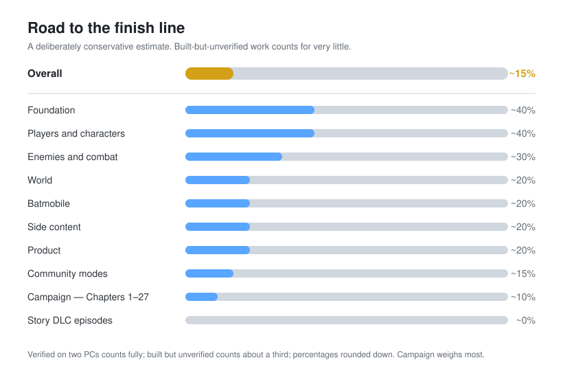

<h1 align="center">Nightfall Together</h1>

  <strong>Online co-op for <em>Batman: Arkham Knight</em> on Steam PC, powered by Nightfall Network</strong>

  Two to five players. One Gotham. One shared campaign.

  <a href="#what-it-does-today">Features</a> •
  <a href="#game-modes">Game Modes</a> •
  <a href="#goal">Goal</a> •
  <a href="#completion-checklist">Completion Checklist</a> •
  <a href="#requirements-testers">Requirements</a> •
  <a href="#legal">Legal</a>

---

> **Development Status — Active development, playable with testers**
>
> Most systems are built and many have been verified across two PCs.  
> The full campaign is **not yet playable from beginning to end in co-op.** Crashing still occurs often at certain times due to active development.
>
> See the [completion checklist](#completion-checklist) for current progress.

**Nightfall Together** is a multiplayer project that lets two to five players share the same Gotham — the same enemies, fights, world state, missions and story — while each player controls the character they choose.

This repository documents the project. **The source code is private and no project files are distributed here.** Each player must own their own copy of *Batman: Arkham Knight* and any DLC they want to use. To play together: https://www.patreon.com/cw/NightfallTogether

---

## What it does today

### Playing together

- **Steam lobbies and invites** — Host from the in-game menu and invite friends, or join a friend's lobby.
- **Late joining** — Players joining an existing session catch up to the current world state using a rebuilt baseline plus the events that have occurred since.
- **Up to five players** in the same open-world Gotham, each controlling their own character.
- **Host migration** — if the host leaves, another player takes over and the lobby rules, voice mutes and menu rows carry across.
- **Join Teammate** — A pause-menu option moves you beside a teammate, or into their current area if they are elsewhere.
- **Team HUD** — Displays each player's character, health and status, including downed, paused, AFK and vehicle states.
- **World markers** — Teammate name tags, compass markers, city-map markers and player pings, each in that character's colour. Press ping again to cancel your own.
- **Same character, different players** — two players on the same character get their own marker colour and a numbered label, and notices name the player.
- **Proximity voice chat.**
- **Collective pause** — The world stops only when everyone is paused. Paused or AFK players are protected.
- **Lobby settings** controlled by the host, including enemy-count scaling from **1x to 3x**.

### Characters

**Current playable roster:**

Batman · Robin · Nightwing · Catwoman · Azrael · Batgirl · Red Hood · Harley Quinn · Joker · Deathstroke

**Stand-in villains** — their own look, on a compatible playable body:

Scarecrow (Nightwing) · Two-Face (Azrael) · Professor Pyg (Harley Quinn) · Penguin (Batgirl) · Riddler (Catwoman)

**Game-mode roles** — requested on the Game Modes tab, not picked in the chooser:

- **Militia** — a Manhunt role: Red Hood's guns and movement in the militia uniform, at a locked 65° view with extra health. It needs the Red Hood story pack. A full first-person rifle is in development.
- **Invader** — an Invasion role: Deathstroke's appearance on Nightwing's movement.
- **Zsasz** — the hunted player in Last Known (in development).
- **GCPD Officer** — hidden from the chooser until the first-person rifle is ready.

When a role ends, your own character comes back automatically.

- Switch characters at any time using the in-game character chooser. Each character has a short description, and a character you cannot pick says why (a DLC this PC lacks, a game-mode role, or the host's game cannot use it).
- Every playable character speaks with its own voice.
- Other players see your selected character's appearance, movement and colour.
- Each character is being brought toward **Batman gameplay parity** where possible:
  - Glide or equivalent traversal
  - Grapple
  - Counters
  - Takedowns
  - Gadgets
  - Detective Mode
- The GCPD officer is the exception on traversal: that body is first person and has no glide or grapple.
- Players who do not own a character's required DLC see a stand-in rather than a broken or missing character, marked (STAND-IN) on the team HUD. If the host swaps your character, you are told once, with the reason.

### Game Modes

Co-op campaign is the default. The host picks and sets up every other mode on one **GAME MODES** tab in the ROOM menu (switch tabs with Q/E or LB/RB). Players ask for a role there, the host's game decides, and a refusal is explained in one line.

- **Manhunt** — Militia against Hunters. The host sets round length, extractions, militia health, field of view and the place (GCPD, Panessa Studios or Ace Chemicals) and starts the round from the tab. Settings hold for the whole round. Militia win by reaching the extraction; the hunters win by thinning them out before the countdown ends. The round does not write the campaign save.
- **Invasion** — player-versus-player. The host selects Invasion and a player takes the Invader role. PvP is only on while a round is running; between rounds everyone is a teammate again. Opposing players trade punches, finishers, cape stuns and car hits, respawn with their own side, and the host keeps a kill and death score.
- **One Night in Gotham** (in development) — a director-run night of city incidents for the whole party.
- **Last Known** (in development) — one player is Zsasz, the rest hunt him by investigation. His live position is never shown to the heroes, not even to a hero host.

### Combat and stealth

- **Shared enemies** — The party fights the same enemies in the same locations.
- The host manages the primary enemy population, while a player who owns a district can simulate and publish its enemies for the rest of the session.
- Punches, counters, takedowns, beatdowns and knockouts resolve against the same enemy on every screen.
- **Dual Play team takedowns** are supported.
- **Synchronized gadgets**, including:
  - Batarangs
  - Explosive Gel
  - Batclaw
  - REC
  - Freeze Blast
  - Smoke
  - Line Launcher
  - And more
- Shared enemy types and encounters include gunmen, brutes, medics, shields, ninjas, drones, tanks and APCs.
- **Predator rooms** — Guards can see and hear every player; takedowns, alarms and fear states are shared.
- **Downed and revive system** — A downed player can be revived by a teammate, while enemies stop targeting the downed player.
- **Bosses** use shared health and synchronized finishes. Bosses, tanks and drones scale with the number of players.
- Splash damage enemies cause to a teammate lands on that teammate.
- Informants can be interrogated by every playable character on the host.

### World and traversal

Remote player movement uses interpolation and prediction, including:

- Running and standard movement
- Gliding
- Grappling
- Diving
- Vents
- Ladders
- Ledges
- Cover
- Cape presentation
- Head look

World interactions stay synchronized between players, including:

- Doors
- Switches
- Cages
- Winchable walls
- Destructible objects
- Lifts
- Puzzles

**Batmobile**

- Every player can have their own Batmobile.
- Driving and battle mode are replicated to other players.
- Winch interactions, weapons and vehicle damage are synchronized, including the Vulcan, the riot suppressor, missile barrages, the EMP pulse and the drone virus.
- Passenger seats are claimed one rider per seat, and the Batmobile-only doors open only for a player in the car.
- Traffic and enemy vehicles are shared.

**Fall recovery**

If a player falls through unloaded or missing world geometry, the system attempts to return them to valid solid ground.

### Progression and side content

- **Missions** — The host drives story progression while objectives, mission selections and Most Wanted progression are followed by the party. A story cutscene waits up to 20 seconds for far teammates and skips anyone AFK, paused, downed or loading.
- **XP and upgrades** are shared by the party, with a +XP line for teammates.
- **Riddler content** — Trophies, riddles, cages and switches count for the group.
- **AR Challenges** can be played together. Challenge packs are offered only when every member owns them.
- **New Game Plus and Knightmare** follow the host's selected difficulty.
- **Separate co-op save system** — Your normal single-player save is never overwritten by a co-op session. Party progression is stored in the mod's own save sidecar.

---

## Goal

> **The full shipped single-player game, playable by two to five people simultaneously, with every relevant entity synchronized and every playable character brought as close to Batman gameplay parity as possible.**

For Nightfall Together, **"in sync"** means a system is wired end to end with the networking behavior expected from an actual multiplayer game — including interpolation and prediction where appropriate — rather than merely appearing approximately similar between machines.

### The finish line

1. **Full campaign completion**  
   Two players, followed by three, four and five players, complete Chapters 1–27 through Knightfall without a blocking desync.

2. **Complete entity synchronization**  
   Every relevant entity visible to a player is synchronized:
   - Enemies
   - Turrets
   - Bosses
   - Friendly NPCs
   - Civilians
   - Traffic
   - World objects
   - Scripted set pieces

3. **Enemy parity**  
   Enemy count, position, animation, target and health match on every player's screen.

4. **Character compatibility**  
   Every supported playable character can reach and complete every required objective.

5. **Full content compatibility**  
   Support for:
   - Main campaign
   - Most Wanted
   - Season of Infamy
   - Story DLC
   - Riddler content
   - AR Challenges
   - New Game Plus
   - Knightmare

6. **Robust multiplayer sessions**
   - Reconnect
   - Host migration
   - Late joining
   - Join at arbitrary campaign points
   - Four-hour continuous-session testing

7. **Release-quality product**
   - Finished menus
   - Installer
   - Privacy handling
   - Release packaging

---

## Completion checklist

**Legend**

✅ **Working and verified on two PCs**  
🟨 **Built, awaiting two-PC verification**  
⬜ **Not completed**

This checklist covers completion of the base game and its DLC in co-op. Community roles and modes are listed separately. They are in the current tester build and still awaiting two-PC verification.

  

> These numbers are a rough, intentionally modest estimate drawn from the checklist below. Much of what is built has not yet been verified, and the full campaign is still the largest piece of work ahead.

### Foundation

- ✅ Steam lobby, invites, join and admission
- ✅ Late join — baseline + event tail
- ✅ Network transport, rate limits and session integrity
- 🟨 Reconnect with every system restored
- 🟨 Host migration when the host leaves
- ⬜ Three-player sessions verified
- ⬜ Four-player sessions verified
- ⬜ Five-player sessions verified
- ⬜ Four-hour soak test within performance budget

### Players and characters

- ✅ Player movement, interpolation and traversal on every screen
- 🟨 Head look, capes, glide and grapple presentation
- 🟨 Character switching displayed correctly on every screen
- 🟨 Every character at Batman parity for traversal, combat and gadgets
- 🟨 Stand-in villains — Scarecrow, Two-Face, Pyg, Penguin and Riddler
- 🟨 Game-mode roles (Militia, Invader) granted on the Game Modes tab; your own character restored afterwards
- 🟨 Downed state, revive, death floor and respawn
- ✅ Team HUD, name tags, compass and map markers
- 🟨 Proximity voice chat

### Community modes

- 🟨 Game Modes tab — one place to pick, configure, staff and start a mode
- 🟨 Manhunt — roles, round settings and start/end on the tab
- 🟨 Invasion — full player-versus-player in progress (roles, PvP only while live, cape stuns, car hits, kill score)
- ⬜ Manhunt first-person rifle for militia and GCPD
- ⬜ One Night in Gotham
- ⬜ Last Known

### Enemies and combat

- ✅ Shared thugs — position, animation and health
- 🟨 Enemy-count parity in every district
- 🟨 Client-owned districts publish their enemies
- 🟨 Every enemy type:
  - Brutes
  - Medics
  - Shields
  - Blades
  - Ninjas
  - Snipers
  - Minigunners
  - Drone operators
- 🟨 Militia tanks, drones and APCs
- 🟨 Turrets and sentries
- 🟨 Every combat move and gadget displayed on every screen
- 🟨 Dual Play team takedowns
- 🟨 Predator rooms — perception, takedowns and alarms
- ⬜ Civilians and friendly NPCs everywhere

### World

- 🟨 Doors, switches, cages, winchables, destructibles and lifts
- 🟨 Puzzles and set pieces
- 🟨 Traffic and parked cars on every screen
- 🟨 Streaming and fall-through protection
- ⬜ Interior and predator-room streaming verified across every chapter

### Batmobile

- 🟨 Each player's own Batmobile
- 🟨 Driving and battle mode
- 🟨 Winch, weapons, damage and ejection on every screen
- ⬜ Mission vehicles and pursuits across every chase and tank section

### Campaign — Chapters 1–27

- 🟨 Mission stages, objectives and story beats followed by every player
- 🟨 Cutscenes held and shared
- 🟨 Checkpoints and party save
- ⬜ Every forced character switch adapted for co-op
- ⬜ Every scripted sequence adapted for co-op
- ⬜ Every boss fight playable together:
  - Firefly
  - Scarecrow
  - Man-Bat
  - Professor Pyg
  - Two-Face
  - Penguin
  - Riddler
  - Hush
  - Azrael
  - Deathstroke
  - Cloudburst
  - Arkham Knight
  - Joker finale
- ⬜ Full campaign playthrough with two players
- ⬜ Full campaign playthrough with four players
- ⬜ Knightfall and 240% completion

### Side content

- 🟨 Most Wanted missions — 14 definitions built, each mission line still to verify
- ⬜ Season of Infamy:
  - Killer Croc
  - Mr. Freeze
  - Ra's al Ghul
  - Mad Hatter
- 🟨 Riddler trophies, riddles, cages and switches
- ⬜ Riddler races and robot fights
- 🟨 AR Challenges — combat, predator and races
- 🟨 New Game Plus and Knightmare
- 🟨 Shared XP, upgrades and WayneTech

### Story DLC episodes

- ⬜ Batgirl: *A Matter of Family*
- ⬜ Harley Quinn Story Pack
- ⬜ Red Hood Story Pack
- ⬜ *Catwoman's Revenge*
- ⬜ *GCPD Lockdown* — Nightwing
- ⬜ *A Flip of a Coin* — Robin

### Product

- 🟨 In-game menus
- 🟨 Character chooser
- 🟨 Lobby settings
- 🟨 Tester package and installer
- ⬜ Ship mode — evidence logging disabled for players
- ⬜ Public release packaging

---

## Requirements (testers)

Each player currently needs:

- ***Batman: Arkham Knight*** on Steam
- Any DLC required for the characters they want to use
- **Arkham Knight Community Patch 4.6**, installed using the latest TFC Installer
- **BmSDK-AK 0.21.0**

Tester builds are distributed privately to invited testers.

---

## Legal

**Nightfall Together is an independent fan project and is not affiliated with or endorsed by Warner Bros., Rocksteady Studios, DC, Epic Games or Valve.**

Players must own a legitimate copy of *Batman: Arkham Knight* and any DLC they use.

**No game assets are distributed by this project.**
